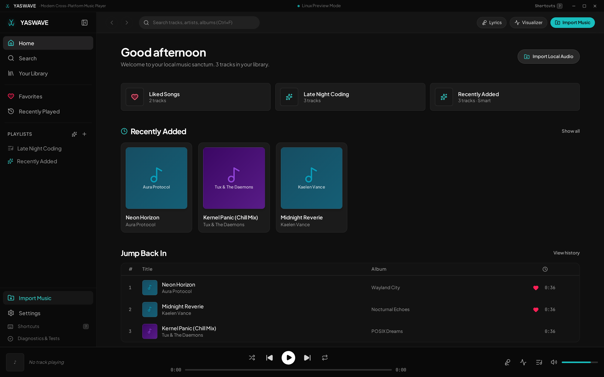
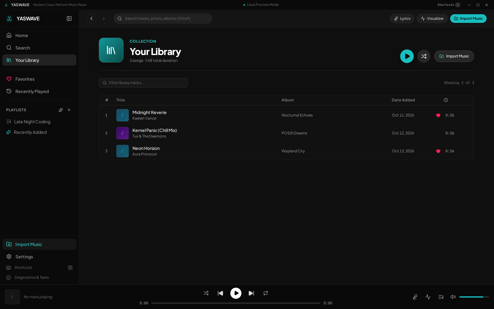
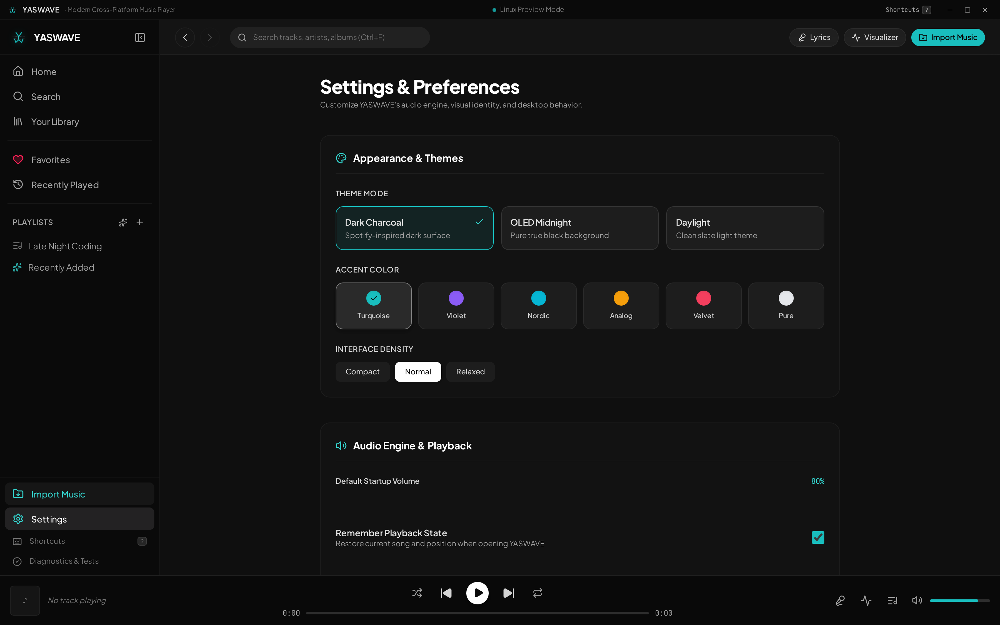

<div align="center">


# 🌊 YASWAVE
### High-Fidelity Cross-Platform Music Player & Lyric Station
**Android • Windows • Linux • Web**

[](https://github.com/Elliotthemyth/YasWave/releases)
[](https://github.com/Elliotthemyth/YasWave/actions)
[](https://github.com/Elliotthemyth/YasWave/releases)
[](#license)

<br/>

[](https://www.typescriptlang.org/)
[](https://react.dev/)
[](https://tauri.app/)
[](https://tailwindcss.com/)
[](https://vite.dev/)
[](https://vitest.dev/)

<p align="center">
  <a href="#-quick-download">Download</a> •
  <a href="#-key-features">Features</a> •
  <a href="#-screenshots">Screenshots</a> •
  <a href="#-architecture">Architecture</a> •
  <a href="#-ci--github-actions-release">CI/CD Pipeline</a> •
  <a href="#-development--building">Build from Source</a> •
  <a href="#-راهنمای-فارسی-persian">راهنمای فارسی</a>
</p>

---

</div>

## 📥 Quick Download

Grab the latest pre-compiled, standalone binaries built directly through GitHub Actions:

| Platform | Format | Architecture | Compatibility | Download |
|:---|:---|:---|:---|:---|
| 📱 **Android** | `.apk` | `arm64-v8a` | Android 7.0+ (Nougat through 15) | [**Download APK**](https://github.com/Elliotthemyth/YasWave/releases/latest) |
| 🪟 **Windows** | `.exe` (NSIS Setup) | `x64` | Windows 10 / 11 | [**Download Installer**](https://github.com/Elliotthemyth/YasWave/releases/latest) |
| 🪟 **Windows Portable** | `.exe` (Standalone) | `x64` | Windows 10 / 11 | [**Download Portable**](https://github.com/Elliotthemyth/YasWave/releases/latest) |
| 🐧 **Linux** | `.AppImage` | `x64` | Ubuntu, Debian, Arch, Fedora | [**Download AppImage**](https://github.com/Elliotthemyth/YasWave/releases/latest) |
| 🐧 **Linux Debian** | `.deb` | `x64` | Debian, Ubuntu, Linux Mint | [**Download DEB**](https://github.com/Elliotthemyth/YasWave/releases/latest) |

> 💡 *All builds include embedded cryptographic checksums (`SHA256SUMS.txt`) to guarantee package authenticity.*

---

## ✨ Key Features

### 🎵 1. Studio-Grade Audio Engine
- **Hardware-Accelerated Playback** — Web Audio API + HTML5 Audio pipeline with sub-millisecond seek accuracy.
- **True Fisher-Yates Shuffle** — Cryptographically balanced shuffle with instant non-destructive order restoration.
- **Loop Modes & Speed Control** — Continuous repeat (`all`, `one`, `off`) with granular tempo manipulation (`0.5x` to `2.0x`).
- **Dynamic Equalizer & Visualizer** — 60 FPS hardware-rendered canvas visualizer supporting **Frequency Bars**, **Radial Spectrum**, and **Oscilloscope Waveforms**.

### 📜 2. Synchronized LRC Lyrics & Persian Translations
- **High-Precision LRC Engine** — Full support for standard and extended LRC format (`[mm:ss.xx]` and `[mm:ss.xxx]`), with automated line-by-line smooth scrolling.
- **Dual-Language Persian Translation** — First-class Persian (فارسی) translation sync line-by-line with bidirectional RTL/LTR layout rendering.
- **Integrated Timestamp Stamper** — Built-in lyric editor with live "Stamp Current Time" buttons and micro-adjustments (`±0.2s` / `±1.0s`).
- **Online Lyrics Discovery** — Automatic LRCLIB synchronization with fuzzy title/artist candidate scoring and duration mismatch protection.

### ⚡ 3. DSP Audio Analysis (BPM & Musical Key)
- **Spectral Energy Flux Tempo Calculation** — Client-side digital signal processing (DSP) computes tempo (BPM) from audio onsets and autocorrelation.
- **Krumhansl-Schmuckler Pitch Class Profiling** — Detects musical keys (Major/Minor) with harmonic confidence scoring.
- **Camelot Wheel Mapping** — Automatic conversion to Camelot notation (e.g. `8A` for A Minor, `8B` for C Major) for harmonic mixing and DJ transitions.

### 📂 4. Native Storage & Zero-Cloud Privacy
- **Android SAF & Scoped File Access** — Reads local audio files on Android using the Storage Access Framework without requiring intrusive global file permissions.
- **Rich Tag Extraction** — In-memory ID3v1, ID3v2, Vorbis, FLAC, and MP4 atom parser via `music-metadata-browser` extracting titles, artists, album names, track numbers, and embedded lossless artwork.
- **Offline-First Resilience** — Local persistence through adapter-swappable IndexedDB / SQLite with instant query capabilities.

### 🎛️ 5. Smart Rule-Based Playlists
- **Condition Engine** — Create smart playlists based on arbitrary combinations of rules:
  - *BPM Range* (e.g. `BPM >= 120 and BPM <= 130`)
  - *Musical Key / Camelot* (e.g. `Key equals A Minor` or `Camelot equals 8A`)
  - *Play Count & Added Date* (e.g. `Play Count >= 5`)
  - *Artist, Album, Genre, Title matching*
- **Automatic Playlists** — Automatically maintained `Liked Songs`, `Recently Played`, and `Recently Added` collections.

### 🎨 6. Responsive UI & Aesthetic Customization
- **Mobile-Native UX** — Adaptive touch controls, bottom navigation, floating mini-player, expandable full-screen player, safe-area inset padding, and Android back button handling.
- **Theme Palette** — Obsidian Midnight (pure OLED black), Cyber Charcoal (slate dark), and Daylight Cream (modern light).
- **Accent Selection** — Logo Turquoise (`#19bebe`), Neon Purple, Sunset Amber, Emerald Green, and Coral Crimson.

---

## 📸 Screenshots

<div align="center">

| 🏠 Now Playing & Library | 📚 Albums & Smart Filters |
|:---:|:---:|
|  |  |

| ⚙️ Themes & Diagnostics | 📱 Android Mobile Experience |
|:---:|:---:|
|  | <br/>*Adaptive Phone & Tablet Layout* |

</div>

---

## 🏗️ Architecture

YASWAVE is architected with a decoupled layer design separating native operating system capabilities from the reactive UI layer:

```
┌────────────────────────────────────────────────────────┐
│               YASWAVE Reactive Frontend                │
│       React 19 + TypeScript + Tailwind CSS 4 + Vite    │
└───────────────────────────┬────────────────────────────┘
                            │
            Adapter Abstraction Layer (Cross-Platform)
         ┌──────────────────┴──────────────────┐
         ▼                                     ▼
┌──────────────────┐                 ┌──────────────────┐
│   Web / PWA      │                 │ Tauri 2 Native   │
│ Browser Sandbox  │                 │ Rust Core Engine │
└────────┬─────────┘                 └────────┬─────────┘
         │                                    │
   Web Audio API                     Native System APIs
   IndexedDB Storage                 Android SAF & Notifications
   LRCLIB Fetch                      Desktop Tray & MPRIS
         │                                    │
         ▼                                    ▼
   Target: Web                       Targets: Android, Windows, Linux
```

### Directory Map

```text
├── .github/workflows/          # CI/CD release engineering (Android, Windows, Linux)
├── docs/screenshots/           # High-resolution screenshots
├── public/                     # Icons, brand monograms, and default assets
├── src/
│   ├── config/                 # APP_CONFIG, brand identity, demo tracks
│   ├── services/
│   │   ├── audio/              # AudioEngine, audioAnalyzer (BPM/Key DSP), visualizer
│   │   ├── filesystem/         # browserFileAdapter & tauriFileAdapter
│   │   ├── lyrics/             # lrcParser, lrclibProvider, persianTranslations
│   │   ├── metadata/           # music-metadata-browser tag reader
│   │   └── storage/            # IndexedDB repository layer
│   ├── hooks/                  # useAudioEngine, useLibrary, useTheme
│   ├── components/             # Views, layout, modals, player, visualizers
│   └── types/                  # Typed models (Track, Playlist, Lyrics, Audio)
├── src-tauri/                  # Rust crate, Cargo config, Android Gradle project
│   ├── gen/android/            # Gradle build configuration & AndroidManifest
│   └── tauri.conf.json         # Tauri 2 app configuration
└── tests/                      # Vitest unit test suite
```

---

## 🚀 CI / GitHub Actions Release

YASWAVE comes with an automated, zero-maintenance GitHub Actions CI/CD pipeline defined in [`.github/workflows/build-all.yml`](.github/workflows/build-all.yml):

```yaml
# Trigger on tag push:
git tag v0.1.0
git push origin v0.1.0
```

### Automated Matrix Jobs:
1. **Windows Runner (`windows-latest`)**:
   - Restores Cargo and Bun caches.
   - Compiles web assets with Vite.
   - Bundles NSIS Installer (`*-setup.exe`) and standalone portable executable.
2. **Linux Runner (`ubuntu-22.04`)**:
   - Provisions WebKit2GTK and multimedia toolchains.
   - Compiles standalone Linux `.AppImage` and Debian `.deb` packages.
3. **Android Runner (`ubuntu-latest`)**:
   - Sets up OpenJDK 17, Android SDK Platform 36, and NDK `26.1.10909125`.
   - Compiles Rust `aarch64-linux-android` native libraries.
   - Generates installable Android `.apk` package.
4. **Release Publisher (`softprops/action-gh-release`)**:
   - Gathers all compiled platform binaries.
   - Computes cryptographic SHA-256 checksums.
   - Publishes an official GitHub Release with downloadable assets.

---

## 💻 Development & Building

### Prerequisites
- [Bun](https://bun.sh) (recommended) or [Node.js](https://nodejs.org) (v20+)
- [Rust](https://rustup.rs) (for desktop native compilation)
- Android SDK & NDK (for mobile packaging)

### Setup & Local Run

```bash
# Clone the repository
git clone https://github.com/Elliotthemyth/YasWave.git
cd YasWave

# Install dependencies
bun install   # or: npm install

# Start development preview on http://localhost:3000
bun run dev   # or: npm run dev

# Run unit tests
bun test      # or: npm test

# Type-check TypeScript
bun run lint  # or: npm run lint

# Build production bundle
bun run build # or: npm run build
```

### Local Tauri Native Builds

```bash
# Build Android APK (arm64)
bunx tauri android build --apk --target aarch64 --debug

# Build Windows Executable & Installer
bunx tauri build

# Build Linux AppImage & DEB
bunx tauri build --bundles appimage,deb
```

---

## ⌨️ Keyboard Shortcuts

| Shortcut | Action |
|:---|:---|
| <kbd>Space</kbd> | Play / Pause |
| <kbd>←</kbd> / <kbd>→</kbd> | Seek Backward / Forward (5s) |
| <kbd>Shift</kbd> + <kbd>←</kbd> / <kbd>→</kbd> | Jump Backward / Forward (15s) |
| <kbd>↑</kbd> / <kbd>↓</kbd> | Volume Up / Down (5%) |
| <kbd>M</kbd> | Mute / Unmute |
| <kbd>L</kbd> | Toggle Lyrics View |
| <kbd>V</kbd> | Toggle Audio Visualizer Mode |
| <kbd>Q</kbd> | Open Up Next Queue |
| <kbd>S</kbd> | Toggle Shuffle (Fisher-Yates) |
| <kbd>R</kbd> | Toggle Repeat Mode (`off` → `all` → `one`) |
| <kbd>Ctrl</kbd> / <kbd>⌘</kbd> + <kbd>F</kbd> | Focus Global Search |
| <kbd>?</kbd> | Open Shortcuts Cheat Sheet |
| <kbd>Esc</kbd> | Close Modal / Fullscreen Player |

---

<div dir="rtl">

## 🇮🇷 راهنمای فارسی (Persian)

### YASWAVE — پخش‌کننده موسیقی پیشرفته و چندسکویی
**نسخه‌های آماده برای اندروید، ویندوز، لینوکس و وب**

**YASWAVE** یک موزیک پلیر مدرن، آفلاین، بدون تبلیغات و متمرکز بر حریم خصوصی است که امکانات حرفه‌ای صوتی را با رابط کاربری زیبا و مدرن ترکیب کرده است.

### 🌟 ویژگی‌های برجسته:
* 📱 **پشتیبانی کامل از اندروید**: طراحی اختصاصی لمسی، ناوبری شناور، مینی‌پلیر، مصرف بهینه باتری و استفاده از Storage Access Framework بدون نیاز به دسترسی‌های ناامن.
* 📜 **لیریک همگام (LRC) با ترجمه اختصاصی فارسی**: هماهنگی خط به خط متن ترانه با ترجمه روان فارسی، اسکرول خودکار هوشمند و ویرایشگر درون‌برنامه‌ای لیریک با دکمه ثبت زمان زنده.
* ⚡ **تحلیلگر هوشمند ضرباهنگ و گام (BPM & Key)**: محاسبه خودکار سرعت آهنگ (BPM) و گام موسیقی با کدگذاری گردونه کملوت (Camelot Wheel) برای میکس هارمونیک و ساخت پلی‌لیست‌های تخصصی.
* 🎨 **ویژوالایزر بلادرنگ ۶۰ فریم**: نمایش طیف صوتی (Spectrum Analyzer)، ویژوالایزر دایره‌ای و اسیلوسکوپ بر پایه Web Audio API.
* 🎛️ **لیست‌های پخش هوشمند**: ساخت پلی‌لیست‌های داینامیک بر اساس شروط (سرعت آهنگ، گام، تعداد دفعات پخش، سبک و خواننده).
* 🌓 **شخصی‌سازی ظاهری**: تم‌های شب مطلق OLED، زغالی تیره و روز روشن به همراه پالت رنگی فیروزه‌ای الهام‌گرفته از لوگو.

### 📥 نحوه دریافت و نصب:
فایل‌های خروجی رسمی به صورت خودکار از طریق GitHub Actions تولید شده و در بخش [**Releases**](https://github.com/Elliotthemyth/YasWave/releases) قابل دانلود می‌باشند:
1. **اندروید**: فایل `.apk` را دانلود کرده و روی گوشی خود نصب نمایید.
2. **ویندوز**: فایل نصبی `Setup.exe` یا نسخه قابل حمل `Portable.exe` را دانلود کنید.
3. **لینوکس**: فایل `AppImage` (بدون نیاز به نصب) یا فایل `deb.` را دریافت نمایید.

</div>

---

## 📄 License

This project is licensed under the [Apache-2.0 License](LICENSE).

---

<div align="center">
<sub>Crafted with passion by the YASWAVE team. Built with React 19, TypeScript, Tauri 2, and Tailwind CSS.</sub>
</div>
